# Optimization of VMD by the Coalition of Positive and Negative Sine and Cauchy Variations for Particle Swarm Optimization. Five fitness functions can be switched at any time. Minimum Envelope Entropy Sample entropy Information entropy Entropy of arrangement Permutation entropy/Mutual Information

Today, we bring you a session on optimizing the VMD parameters using a sparrow search algorithm that integrates cosine and Cauchy mutation. 
Taking the Xi'an Jiaotong University dataset as an example, we selected 1000 data points from X105_BA_time.mat in the 105.mat file. If you don't have data, please read this article. Xi'an Jiaotong University bearing diagnostic data processing, free MATLAB code available  
We chose five fitness functions for optimization to determine the optimal k and α parameters of VMD. The four fitness functions are: minimum envelop entropy, minimum sample entropy, minimum information entropy, and minimum arrangement entropy. The code allows for one-click switching between these functions. As for which fitness function to choose, you can refer to this article. Why does VMD need parameter optimization? Which is the best among minimum envelop entropy/sample entropy/arrangement entropy/information entropy, and which fitness function should be chosen? 
1. Minimize Envelop Entropy as the fitness function  
2. Minimize Sample Entropy as the fitness function  
3. Minimize Information Entropy as the fitness function  
4. Minimize Arrangement Entropy as the fitness function  
5. Composite Index as the fitness function  
Regarding the composite index, here is a brief introduction:  
Result graph:  
Code:
%% Optimize VMD using SCSSA algorithm to minimize entropies of minimum enclosing envelope, minimum sample entropy, minimum information entropy, minimum permutation entropy, and arrange entropy/mutual information entropy as objective function (choose one).\nclear\nclc\nclose all\nxz = 2;  %xz, select 1, using the minimum entropic fitness function.\n% Select 2, using the minimum sample entropy as the fitness function.\n% Select 3, using the minimum information entropy as the fitness function.\n% Select 4, using the minimum arrangement entropy as the fitness function.\n% Select 5, using the compound index: Arrangement Entropy/Mutual Information Entropy as the fitness function.\nif xz == 1  \n    fobj=@EnvelopeEntropyCost;          % Minimum Entropy\nelseif xz == 2\n    fobj=@SampleEntropyCost;            % Minimum sample entropy\nelseif xz == 3\n    fobj=@infoEntropyCost;              % Minimum Entropy\nelseif xz == 4\n    fobj=@PermutationEntropyCost;       % Minimum Arrangement Entropy\nelseif xz == 5\n    fobj=@compositeEntropyCost;       % Composite indicator: Arrangement Entropy / Mutual Information Entropy\nend\n%% Select data\nload 105.mat\nda = X105_DE_time(6001:7000); % Here, select the DEtime data of 105, note that you can replace this with your own data. The data format is n rows * 1 column, and the number of columns must be 1.\n\n%% Set parameters\nlb = [100 3];    % Penalty factor and the lower bound of K\nub = [2500 10];  % Penalty factor and the upper limit of K\ndim = 2;            % Optimize the number of variables\nMax_iter=20;       % Maximum number of iterations\nSearchAgents_no=20;       %Population size\n\n%% Call SCSSA function\n[fMin , bestX, Convergence_curve ] = SCSSA(SearchAgents_no,Max_iter,lb,ub,dim,fobj,da);\n\n%% Plot the fitness function curve and output the optimal parameters.\nfigure\nplot(Convergence_curve,'Color',[0.9 0.5 0.1],'Marker','>','LineStyle','--','linewidth',1);\ntitle('Objective space')\nxlabel('Iteration');\nylabel('Best score obtained so far');\nlegend('SCSSAOptimizationVMD')\ndisplay(['The best solution obtained by SCSSA is : ', num2str(round(bestX))]);  % Output the best location\ndisplay(['The best optimal value of the objective funciton found by SCSSA is : ', num2str(fMin)]);  %Output the best fitness value\nEveryone, pay attention to see.xzThis variable, when selected.1, Using the minimal entropic fitness function, select.2, Using the minimum sample entropy as the fitness function, select.3, The fitness function is the minimum information entropy, and selection is made.4, Using the minimum permutation entropy as the fitness function, selection is made.5, Compound indicator: Sorting Entropy/Mutual information entropy serves as the fitness function. This makes it convenient for everyone to switch.。  
The code includes the test of the sparrow algorithm with integration of cosine and kaczmarz mutation in CEC2005 function and SCSSA optimization VMD.

## Images

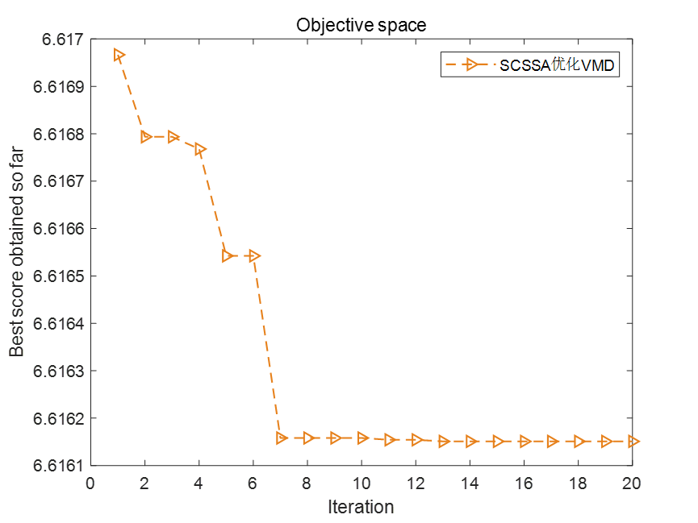
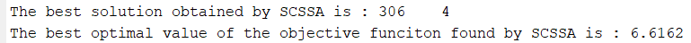
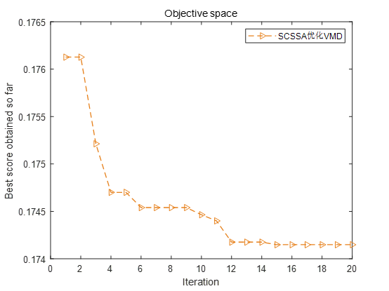
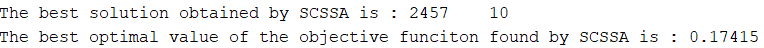
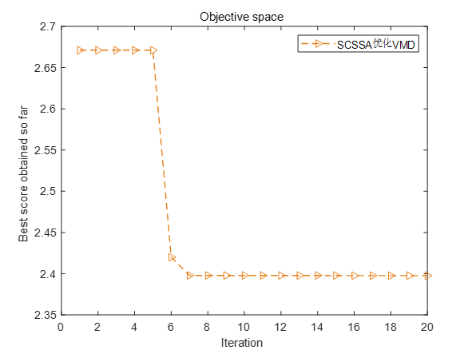
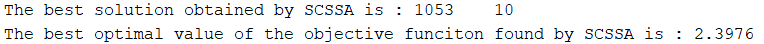
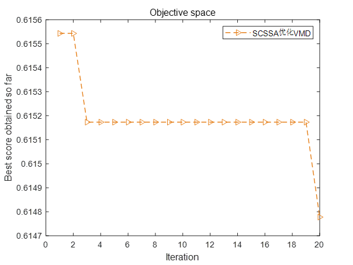
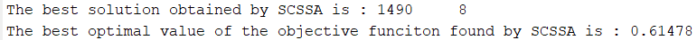

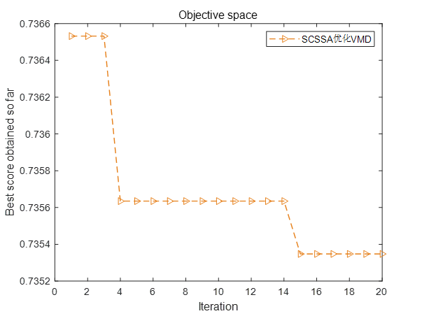
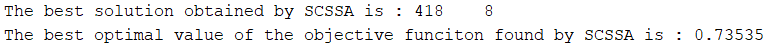
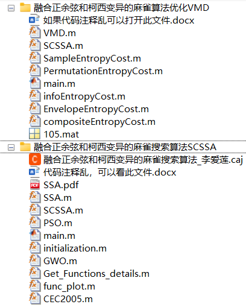

<!-- PAYMENT_BLOCK -->

## Get this dataset

- Payment link (Stripe): [Buy now](https://buy.stripe.com/3cs8yP7sY87d0vu9AB)
- Payment QR code: 

<!-- /PAYMENT_BLOCK -->
